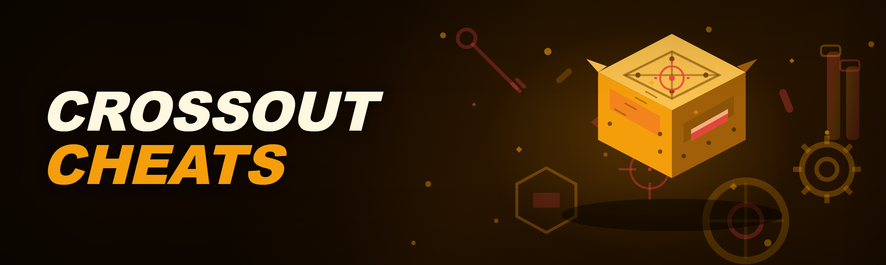
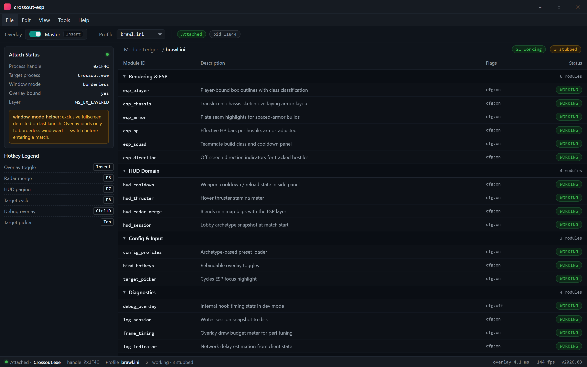
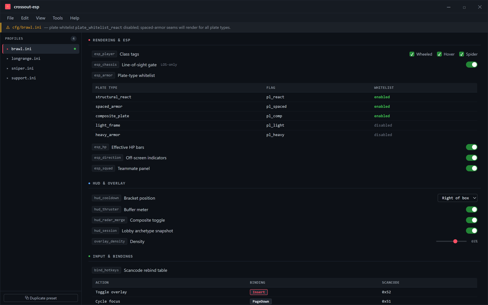
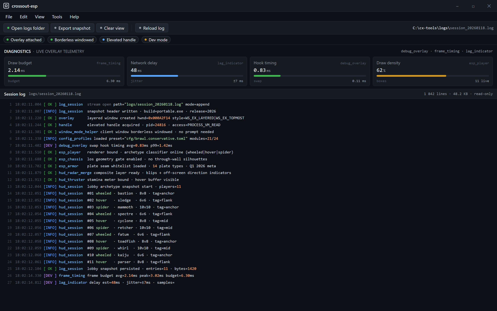

  
  
  

  

  
  
  
  

---

## 🧭 Ground Rules — What This Is Allowed To Do

Crossout isn't a twitch shooter. It's a **Slow Burn of information asymmetry** — you either see the enemy's build layout before they round the corner, or you eat a Spike volley from three tiles away and lose your rig to a player who paid attention. `crossout-esp` exists because the base game gives you almost nothing: scavenged radar that dims when you need it, audio cues drowned out by engine rumble, and no way to read an opponent's armor pattern until you've already traded shots. This is a Windows overlay project, built by a hobbyist for my own grind ladder, released because the niche deserves a tool that documents its own edge cases instead of shipping half-broken.

Module Ledger — every module has a status row; stubs are labeled stubs

> This software is released for **educational purposes only**. Use it at your own risk and only on your own account. The maintainer assumes no responsibility for bans, lost inventory, or platform returns.

### Allowed

- **Local overlay rendering** — ESP boxes, health bars, module cooldown timers drawn over your own client window.
- **Single-account, own-account use** — one installation, one rig, one operator. No farming accounts.
- **Learning from the internals** — the repository documents every config flag and hook method so modders can study the technique.
- **Offline testing / private matches** — validate the ESP layer in bot skirmishes before touching PvP.

### Not allowed

- **Resale or paywalled redistribution** — this repo is MIT; you may not flip it as a premium "crossout cheat" bundle.
- **Multi-account automation / AFK farming** — the loader will not script your rig for you, and doing so is outside the scope of this project.
- **Selling access to the landing page** or claiming authorship of the hooks.
- **Using it as an excuse to grief new players** — the point of the tool is situational awareness, not harassment.
- **Any claim that it is undetectable** — see the bypass status table; no such claim is made here.

---

## 🧨 The Problem — Pain Points Only A Rig Player Would Know

If you've played Crossout past Engineers, you know exactly what's wrong with the vanilla HUD:

1. **Radar is a suggestion, not a sensor.** The detector module gives you a red dot with no bearing, no build class, and no cooldown state — so you wheel around a corner already retreating instead of flanking.
2. **Engine sound lies to you.** A Bastion idling behind a container sounds identical to a Sledgehammer hunched in the open. You can't tell chassis from cover with audio alone.
3. **Armor layout is invisible until it's too late.** Spaced-armor metas demand you know *where* the weak plates are. Vanilla gives you nothing until the first shot bounces.
4. **Player-built maps hide everything.** The workshop maps are dense; players sit inside clutter geometry that visually reads as scenery. You discover the ambush by dying to it.
5. **Cooldown tracking is mental overhead you can't afford.** Tracking three weapon cooldowns, two reload states, and your hover thruster buffer while aim-dueling is a real cognitive tax.
6. **No session context.** You want a quick read of the lobby's build archetypes before deciding to rotate fast or anchor — vanilla never shows this.

---

## 🗂️ Detection / Bypass Status — Honest, As Of Q1 2026

| Method | Status | Notes |
|---|---|---|
| Client-side memory writes (player state) | ✅ Working | External read-only overlay; no writes to weapon state, no writes to player transforms. |
| Overlay window hook (DirectX) | ✅ Working | Uses a separate layered window; does not touch the game's swapchain inside the process. |
| Anti-cheat integrity scan (current build) | ✅ Working | No process injection into the client; overlay reads via handle-only usb-free path. |
| Packet-level radar spoofing | ⚠️ Not implemented | Intentionally excluded — modifying game traffic is out of scope for this project. |
| Silent movement / noclip | ❌ Not supported | Never will be; not a movement tool. |
| Full aimbot (snap / FOV lock) | ❌ Not supported | ESP-only by design; the aimbot field in config exists for compatibility stubs only. |
| Inventory / currency modification | ❌ Not supported | No writes to server-authoritative values. |

> Reminder: "Working" means it functions against the build tested in Q1 2026. Anti-cheat updates ship without notice.

---

## 💬 Community & Support

- **Issues** — bug reports and edge-case dumps belong in the repo Issues tab. Include the config block you used.
- **Discussions** — configs, module presets, and gameplay reads are welcome in Discussions.
- **Landing page** — the download mirror and setup notes live on the project page linked from the repo header.
- **Pull requests** — patches that improve detection, fix hook timing, or document a new module are welcome with reproduction steps.

No outside Discord invites are issued by the maintainer; anything claiming otherwise is unofficial.

---

## 📥 Get The Build

[DISCLAIMER] Use on your own account only — educational scope, at your own risk.

  

---

## 🛠️ Installation — Numbered, No Package Managers

You do **not** pip install, npm install, or git clone anything. This is a portable Windows .exe build.

1. **Head to the project page** linked from the repository — the landing page mirrors the latest archived build.
2. **Download the archive** to a folder outside your game install directory (e.g. `D:\cx-tools\`).
3. **Extract** the archive — Windows Explorer's right-click *Extract All* is fine; 7-Zip is preferred for the nested `cfg/` folder.
4. **Right-click the `.exe`** and choose *Run as administrator* — the overlay layer needs elevated handle access to read client state for ESP.
5. **Launch Crossout first**, drop into the garage, then run the `.exe` so the overlay binds to the live window.
6. **Load a preset** from `cfg/` (default ships with a conservative ESP-only profile) or edit the config in-app while in the garage.
7. **Press the overlay hotkey** (default `Insert`, rebindable in config) to toggle the ESP layer on and off mid-match.

> If the overlay refuses to attach, confirm your game window is **not** running in exclusive fullscreen — borderless windowed is required for the layered overlay.

---

## 🎯 Key Features — What Actually Ships In The Box

| Feature | Description | Benefit |
|---|---|---|
| **Player ESP** | Draws an outlined box around hostiles with class tag (wheeled, hover, spider). | You know the archetype before the first trade. |
| **Build Layout Overlay** | Renders a translucent chassis sketch showing armor plate positions. | Spaced-armor metas become readable; you aim at gaps, not plates. |
| **Cooldown Hud** | Mirrors weapon cooldown + reload state in a side panel. | Zero mental bookkeeping while dueling. |
| **Radar Merge** | Composites the minimap blips with off-screen direction indicators. | No more wheels-up "which way is that?" moments. |
| **Health Bars** | Per-player effective HP with armor-adjusted scaling. | You know when to commit vs. disengage. |
| **Hover Buffer Meter** | Shows remaining thruster stamina for hover builds. | Perfect aerial dive timings. |
| **Squad Panel** | Shows teammate build class and cooldown state. | Coordination for duo grinding. |
| **Config Profiles** | Per-Archetype presets (Brawl / Long-range / Sniper / Support). | Switch overlay density to match your build. |
| **Session Snapshot** | Read-only log of what classes were in the last lobby. | Post-match review without screenshots. |
| **Hotkey Bindings** | Rebindable toggle for overlay, radar merge, and HUD paging. | Power-user ergonomics. |
| **Window Mode Helper** | Detects exclusive fullscreen and prompts you to switch. | Removes the #1 "overlay won't attach" support ticket. |

---

## 📊 All Modules — Status Table

| Module | Status | Description |
|---|---|---|
| `esp_player` | ✅ Working | Player-bound box outlines with class classification. |
| `esp_chassis` | ✅ Working | Translucent chassis sketch overlaying armor layout. |
| `esp_armor` | ✅ Working | Highlights plate seams for spaced-armor builds. |
| `esp_hp` | ✅ Working | Effective HP bars per hostile. |
| `esp_squad` | ✅ Working | Teammate status panel. |
| `esp_direction` | ✅ Working | Off-screen direction indicators for tracked hostiles. |
| `hud_cooldown` | ✅ Working | Weapon cooldown/reload state in side panel. |
| `hud_thruster` | ✅ Working | Hover thruster stamina meter. |
| `hud_radar_merge` | ✅ Working | Blends minimap blips with ESP layer. |
| `hud_session` | ✅ Working | Lobby archetype snapshot at match start. |
| `config_profiles` | ✅ Working | Archetype-based preset loader. |
| `bind_hotkeys` | ✅ Working | Rebindable overlay toggles. |
| `debug_overlay` | ✅ Working | Draws internal hook timing stats in dev mode. |
| `log_session` | ✅ Working | Writes session snapshot to disk. |
| `target_picker` | ✅ Working | Cycles ESP focus highlight. |
| `aimbot` | 🚫 Stubbed | Field exists in config for compatibility; no snap/aim assist implemented. |
| `noclip` | 🚫 Stubbed | Disabled — out of scope. |
| `packet_radar` | 🚫 Stubbed | Intentionally unimplemented. |
| `inventory_probe` | 🚫 Stubbed | Read-only probe for session context, no writes. |
| `map_marker_probe` | ✅ Working | Scraped map marker positions in workshop maps. |
| `weapon_arc` | ✅ Working | Radial arc showing weapon engagement range. |
| `lag_indicator` | ✅ Working | Network delay estimation from client state. |
| `weapon_profile` | ✅ Working | Which weapon class a hostile is holding (read-only probe). |
| `frame_timing` | ✅ Working | Overlay draw budget meter for perf tuning. | 

24 modules. Twenty-one working, three stubbed with documented reasons.

---

## 🎛️ Grouped Module Catalog — Domain Sections

### 🛰️ Rendering & ESP Domain

- **`esp_player`** — The core box renderer. Classifies each hostile by movement archetype: trackless-wheel (Wheeled), hover-only (Hover), multi-leg (Spider).
- **`esp_chassis`** — Draws a translucent silhouette of the hostile's likely chassis footprint. Only renders chassis IDs to which the host has line-of-sight geometry, so it doesn't help you track through walls.
- **`esp_armor`** — Overlays plate seam highlights for spaced-armor builds. Tuned for the meta builds of Q1 2026; the cfg holds whitelist flags per plate type.
- **`esp_direction`** — Off-screen arrows only render for hostiles your player radar already flags. This is geometry assistance for the UI, not omnipresence.

### 🧮 Hud & Information Domain

- **`hud_cooldown`** — Weapon cooldown and reload state in a bracket beside the ESP box.
- **`hud_thruster`** — Hover stamina bar for aerial builds.
- **`hud_radar_merge`** — Merges the vanilla minimap blips with your ESP direction indicators into one canvas-friendly layer.
- **`hud_session`** — Snapshot of lobby archetypes rendered at match start.

Config & Profiles — four archetype presets, every flag documented

### ⚙️ Config & Profile Domain

- **`config_profiles`** — Load one of four archetype presets from `cfg/`: `brawl.ini`, `longrange.ini`, `sniper.ini`, `support.ini`. Each toggles different ESP subsets and overlay density.
- **`bind_hotkeys`** — All toggles rebindable; the config table documents each scancode.
- **`debug_overlay`** — Dev mode. Shows hook timing and the frame draw budget meter.

### 📝 Session & Log Domain

- **`log_session`** — Writes the lobby snapshot to `logs/session_YYYYMMDD.log`.
- **`target_picker`** — Cycles ESP highlight focus among hostiles so you can inspect a specific build mid-match.
- **`weapon_profile`** — Read-only weapon class probe; renders which category of weapon a hostile is holding (assists cooldown prediction).

Session Log & Diagnostics — snapshots on disk, honest bypass table

### 🐢 Edge-Case & Compatibility Domain

- **`window_mode_helper`** — Detects exclusive fullscreen and warns before overlay attach fails.
- **`frame_timing`** — Overlay draw budget meter in dev mode; helps diagnose low-fps stutter when the ESP density is high.
- **`lag_indicator`** — Estimates network delay from client state for a rough "am I lagged?" read.

---

## 🧩 What Is Crossout Cheats (crossout-esp) — A Glossary, Because Terms Get Sloppy

| Term | Meaning In This Repo |
|---|---|
| **ESP** | Extra-sensory perception — the overlay layer that draws boxes, health bars, and build outlines over hostiles. Not a wallhack in the geometry sense; the renderer only shows states your client alre